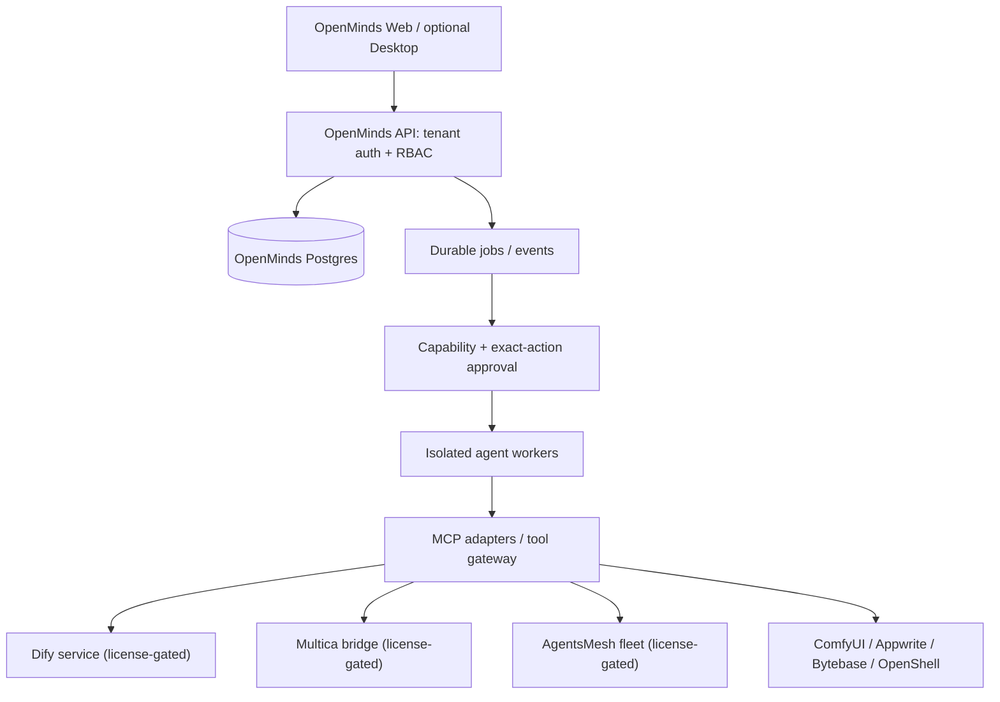

# Worlds AI Minds — Integration Architecture (proposal, not a deployed merge)

OpenMinds stays the product/control-plane owner. The upstream platforms retain their own
licenses, schemas, identity systems and process boundaries until specific adapters are
implemented, tested and approved. Do not copy all upstream source trees into the server
application or connect their databases directly.

## Target topology



## Ownership boundaries

| Concern | OpenMinds owner | Adapter responsibility |
|---|---|---|
| Identity | OpenMinds tenant + human/agent principals | Map scoped external identities, never share master credentials |
| Collaboration | Tasks, approvals, assignment event log | Translate Multica/Paperclip event schemas with idempotency |
| Workflows | Versioned DAG, checkpoints and review states | Dify/ComfyUI execute approved graph nodes through APIs |
| Agents | Durable job state, budgets, capability grants | Pydantic AI/Ruflo/Orca/T3Code operate in isolated runtime |
| Fleet | Worker leases and resource policy | OpenShell or separately licensed fleet provides enforcement |
| Data | PostgreSQL transactional source of truth | Redis delivery, object storage, evidence attestations |
| Mobile | Session-scoped device permissions | Explicitly approved mobile-use connector |
| Database ops | Migration policy and rollback audit | Bytebase as optional governance service |
| Memory | Provenance and retention | Hindsight/context-mode require scoped opt-in |
| Media | Graph and artifact references | ComfyUI separate process/GPU resource pool |

## Integration protocol

1. Register connector with `id`, endpoint, version, tenant, capabilities, health.
2. Authenticate outbound calls using per-tenant scoped credentials from secret storage.
3. Map OpenMinds task IDs to external workflow/job IDs; use idempotency keys.
4. Require policy decision before action, then record exact arguments hash.
5. Persist async state transitions and immutable evidence pointers.
6. Enforce timeouts, retries, cancellation and crash-reconciliation.
7. Surface honest health states: `unconfigured`, `disconnected`, `healthy`, `degraded`.
8. Do not show agent or fleet counts without live evidence.

## Prioritized delivery

**Wave A — one working vertical slice:** OpenMinds login, tenant project, create task,
review and approve, isolate one coding worker, persist result and evidence, browser test.

**Wave B — connector SDK:** Tool discovery and MCP bridge; Pydantic AI first, ComfyUI
optional. Test tenant permissions, event deduplication, crash recovery and malicious inputs.

**Wave C — managed external integrations:** Appwrite, Dify, Multica, AgentsMesh,
Bytebase and OpenShell behind independent deployment configs. Do not deploy restricted
source commercially without suitable rights.

**Wave D — desktop/mobile:** Ensemble or Taku only after platform, license, signing,
device permissions and actual hardware checks.

## Upstream usage policy

Review `integrations/upstreams.json` before fetching. The helper
`scripts/fetch_upstreams.py` permits explicit snapshots of entries marked
`source-eligible`. It blocks restricted services and unresolved licenses.
It does not install dependencies, add gitlinks, start network services, or verify
that repositories share compatible versions.

Example:

```bash
python3 scripts/fetch_upstreams.py \
  --include ruflo --include paperclip \
  --destination ./upstreams \
  --archive ./dist/openminds-upstreams.zip
```

Large archives can require substantial disk/network capacity. Do not check generated
`upstreams/` or `dist/` into the application without a separate license and
supply-chain review.

## Open questions

- Mobile-use means `minitap-ai/mobile-use` or `MadeAgents/mobile-use`?
- Will OpenMinds be privately self-hosted or publicly multi-tenant SaaS?
- Are commercial licenses available for Dify, Multica and AgentsMesh?
- Is the desktop target Linux GTK, macOS, or browser/PWA first?
- Which LLM/model provider credentials are approved for integration tests?

No integrated production deployment, tests or external source merge is claimed here.
